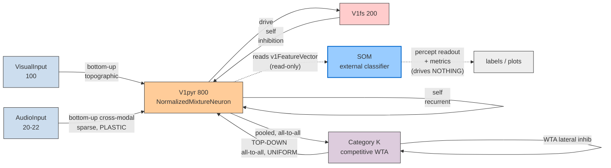

# Architecture of the current committed model (v3.1)

A precise description of the populations, connectivity, and math **as actually
implemented on branch `claude/serotonin-av-retinotopic-owdd0w`**, written to get
us on the same page. The one thing to read first is the **two-classifier
situation** (§7), because it's the source of the confusion.

Source files: `RetinotopicGrandPlanNetwork.py` (populations + wiring),
`NormalizedMixtureNeuron.py` (V1 math), `RateNeuron.py`/`CellTypes.py` (transfer),
`RateAxon.py` (synapse + serotonin transmission), `Classifiers.py` (SOM),
`RetinotopicV31Simulation.py` (experiment loop + emergent controller).

Everything below is the `useART=False` configuration, which is what v3.1 runs.

---

## 1. Populations

At the default 10×10 grid (`gridSize=10` → `nCols=100`), `cellsPerColumn=8`,
`fsPerColumn=2`, `categoryCount=K`:

| population     | size                    | cell type                | role |
|----------------|-------------------------|--------------------------|------|
| `VisualInput`  | `nCols` = 100           | rate input (clamped)     | edge-map pixel rates, one per retinotopic column |
| `AudioInput`   | `audioBins` (20, or 22 real) | rate input (clamped) | sound-clip band powers |
| `V1pyr`        | `nCols·cpc` = 800        | **NormalizedMixtureNeuron** (Pyramidal) | V1 — the Sulfaro mixture cells |
| `V1fs`         | `nCols·fpc` = 200        | RateNeuron (FS)          | local feedforward inhibition |
| `Category`     | `K` (2–3)               | RateNeuron (Pyramidal)   | built-in competitive secondary area → drives top-down |

`VisualInput` and `AudioInput` are clamped each presentation; everything else is
dynamic. (When `useART=True`, `Category` is replaced by a `TopDown` input
population the ART classifier writes into — not used in v3.1.)

## 2. Connectivity

All weights carry ±10% Gaussian jitter. `cpc=cellsPerColumn`, `fpc=fsPerColumn`.

| projection                | pattern                                   | weight (per synapse)              | Sulfaro stream |
|---------------------------|-------------------------------------------|-----------------------------------|----------------|
| `VisualInput → V1pyr`     | topographic, RF radius `topographicRadius=1` | `visualWeight/cpc` (500/8)     | **bottom-up** |
| `AudioInput → V1pyr`      | sparse all-to-all, prob `audioToV1Likelihood=0.3`; **plastic** (remapping) | `audioWeight/audioBins` (300/20) | **bottom-up** (cross-modal) |
| `V1pyr → V1pyr`           | within-column recurrent excitation        | `v1RecurrentWeight/cpc` (120/8)   | **self** |
| `V1pyr → V1fs`            | within-column                             | `v1ToFsWeight/cpc` (300/8)        | (drives inhibition) |
| `V1fs → V1pyr`            | within-column                             | `fsToV1Weight/fpc` (−300/2)       | **self** (inhibition) |
| `V1pyr → Category`        | **all**-to-all pooling (reads whole V1)   | `v1ToCategoryWeight/(nCols·cpc)`  | — |
| `Category → Category`     | lateral inhibition (winner-take-all)      | `categoryInhibitionWeight` (−50)  | — |
| `Category → V1pyr`        | **all**-to-all, **uniform**               | `categoryToV1Weight/K` (400/K)    | **top-down** |

Visual and Audio axons carry **axonal 5HT2A** receptors (serotonin raises their
transmission gain). The Audio→V1 axons are the ones that undergo Hebbian
plasticity (the cross-modal remapping).



## 3. V1 cell — the Sulfaro normalized mixture

Each `V1pyr` cell regroups its per-source synaptic currents into three streams
(bottom-up = Visual+Audio; self = recurrent+FS; top-down = Category), then takes
the **weight-normalized convex combination** at the *current* level:

```
         w_bu·I_bottomup + w_td·I_topdown + w_self·I_self
I_mix = ---------------------------------------------------
                   w_bu + w_td + w_self

I_total = I_mix + diffuseCurrent + externalInput          (soma offsets, outside the mix)
rate   += (dt / tau_m) · ( F(I_total) − rate )
```

- Stream weights default `w_bu = w_td = w_self = 1` (`wBottomUp/wTopDown/wSelf`).
  **`w_bu / w_td` is the perception knob**: >1 veridical, <1 top-down/hallucinatory.
- `w_bu` is further scaled by `bottomUpGain` (the 5HT2A hook).
- `diffuseCurrent` (somatic serotonin) and `externalInput` (the intrinsic
  excitability drive) are **additive offsets, outside** the normalized mixture.

## 4. Transfer function (all cells)

Threshold power-law fit to the Izhikevich f–I curves (`CellTypes.py`):

```
F(I) = k · max(I − θ, 0)^n
Pyramidal: k=0.0823, θ=59.51, n=0.830, tau_m=20 ms
FS:        k=0.616,  θ=57.60, n=0.947, tau_m=10 ms
```

## 5. Serotonin (three distinct actions)

1. **Somatic diffuse** — an additive soma current `Σ receptorWeight · level`
   (5HT2A weight +5, 5HT1A −1, baseline `serotoninLevel=10`). Outside the mixture.
2. **Axonal 5HT2A** — on Visual+Audio transmission axons: `w_eff = weight·(1−failureRate)`,
   and 5HT2A **lowers** `failureRate`, raising transmission gain.
3. **5HT2A → `bottomUpGain`** (when `serotoninShiftsMixture`) — raising 5HT2A
   lowers the bottom-up stream weight (the Sulfaro/Seillier bridge).

## 6. The emergent homeostatic controller (experiment-level, not a population)

`RetinotopicV31Simulation` runs a closed loop: it reads an EMA of the deprived
region's firing, forms a deficit, drives a latent `h ∈ [0,1]`, and scales five
deprivation responses by `h` (intrinsic excitability drive, `bottomUpGain`,
reduced somatic 5HT, raised cross-modal axonal 5HT, lowered plasticity
threshold). Asymmetric ramp/relax time constants make it underdamped (transient
hyperactivity overshoot). Only the sensory loss is imposed; the rest emerges.

## 7. The classifier and the top-down loop

> **UPDATE (closed loop implemented).** The SOM now drives the Sulfaro top-down
> directly: the winning node's weight vector (a V1-space template of the
> recognised category) is projected back as **topographic** top-down each step,
> via a `TopDown` population (`somTopDown=True`, SOM only). The untrained
> `Category` layer is retired for the SOM path. Verified: the top-down now carries
> class structure (separability 4.12 vs 0.50 before; SOM-on-top-down accuracy 1.00
> vs 0.29). `somFeedbackGain` × the Sulfaro `wTopDown/wBottomUp` is the
> veridical↔hallucination dial. The description below is kept for the earlier
> open-loop state and still applies to the non-SOM backends (which stay pure
> readouts with the `Category` layer driving a uniform top-down).

Earlier (open-loop) state and the non-SOM backends: **there were two separate
"category" systems, not connected.**

| | **`Category` population** | **SOM (`Classifiers.py`)** |
|---|---|---|
| where | **inside** the network | **external** to the network |
| role | generates the **Sulfaro top-down** stream | produces the **percept readout + metrics** |
| trained? | **no** — fixed gaussian weights; all V1→each category equally, so the WTA winner is essentially noise-driven | **yes** — pretrained on sighted V1, learns continuously |
| feedback to V1 | yes, but **all-to-all uniform** (no spatial/category structure) | **none** — read-only |

So: **the thing we've been tuning (the SOM) is a read-only observer. The
top-down in the Sulfaro mixture is driven by the untrained `Category` WTA
layer**, whose feedback is spatially uniform. Measured: the top-down pattern has
~2% spatial variation and classifies at chance.

This is why:
- the top-down doesn't match the bottom-up that drove a classification (the
  `Category` layer never learned any template);
- classifying the top-down is uninformative (it's uniform);
- the hallucinations observed so far are **bottom-up (audio-remapping) driven
  misclassifications read by the SOM**, not top-down-generated percepts.

In the **ART** experiments (`useART=True`) this was different: the ART classifier
*was* the secondary area and wrote a **topographic** top-down template into the
`TopDown` population — classifier was in the loop. v3.1 swapped the readout to the
external SOM but left the in-network top-down on the vestigial `Category` layer.

### The decision

To make the model do what the Sulfaro framing intends — top-down = a learned
category **prediction** that competes with sensory input — the **SOM should
replace `Category` as the top-down source**: the winning SOM node projects its
weight vector (which already stores the class's V1 template) back as
**topographic** top-down. Then top-down matches bottom-up by construction, is
classifiable, `w_td/w_bu` becomes the real veridical↔hallucination dial, and
top-down dominance yields genuine hallucinated categories (the CBS mechanism).

This is the "close the SOM→V1 loop" step. It's the natural next change; this
document is the baseline we'd be changing from.

## 8. Experiment flow (`RetinotopicV31Simulation.run`)

1. warmup (no input) → **pretrain** the SOM on a short *sighted* exposure
   sequence (trial-distribution features);
2. **sighted baseline** (plasticity ON from the start), set-point measured;
3. **impose sensory loss** (scotoma/blind) + activate the emergent controller;
4. **post-loss** window (deprivation → recovery → long stable tail).

Per presentation it records: readout (cluster/label/confidence), deprived &
intact rates, `h`, remap weight, **visual / audio / top-down drive currents**,
the V1 feature vector, and SOM snapshots.
